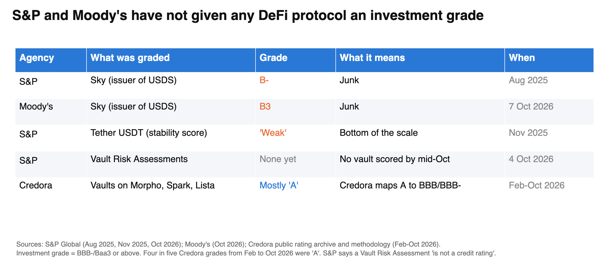
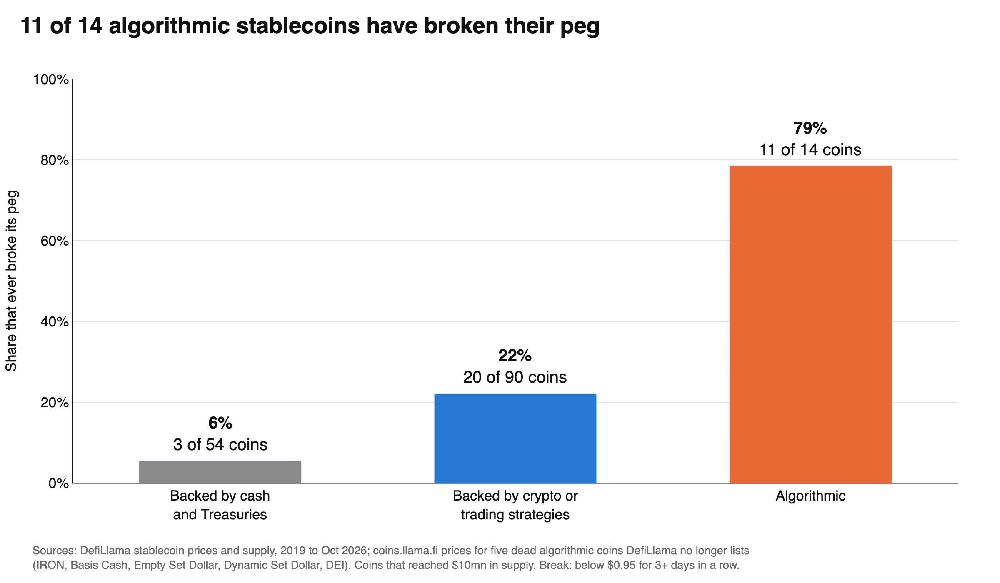
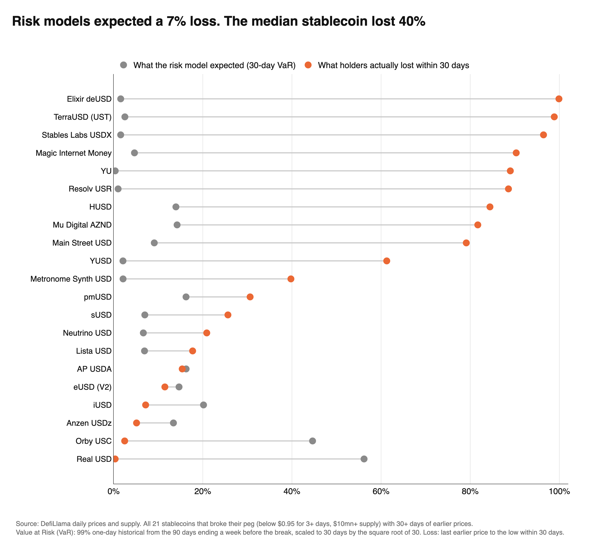
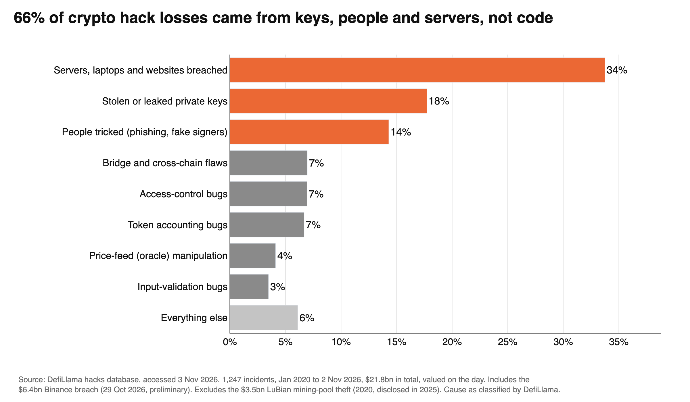
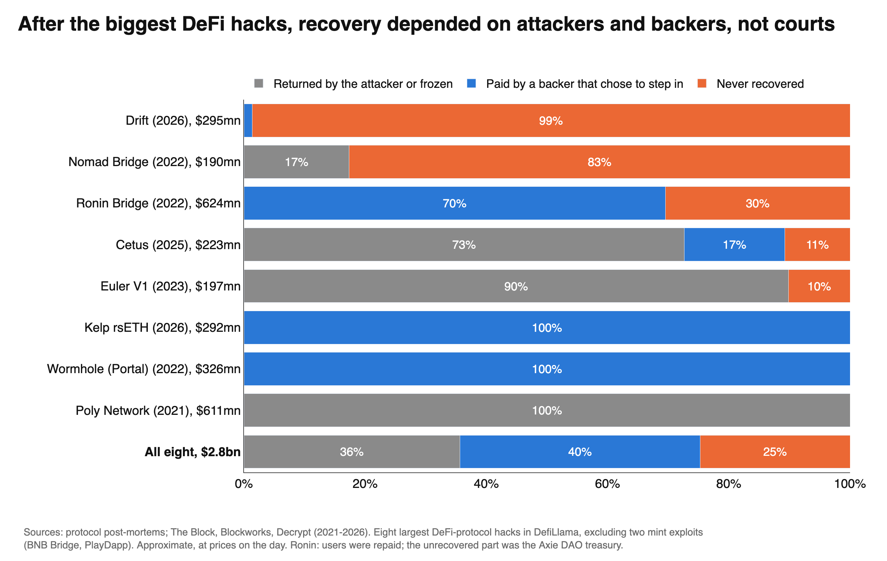
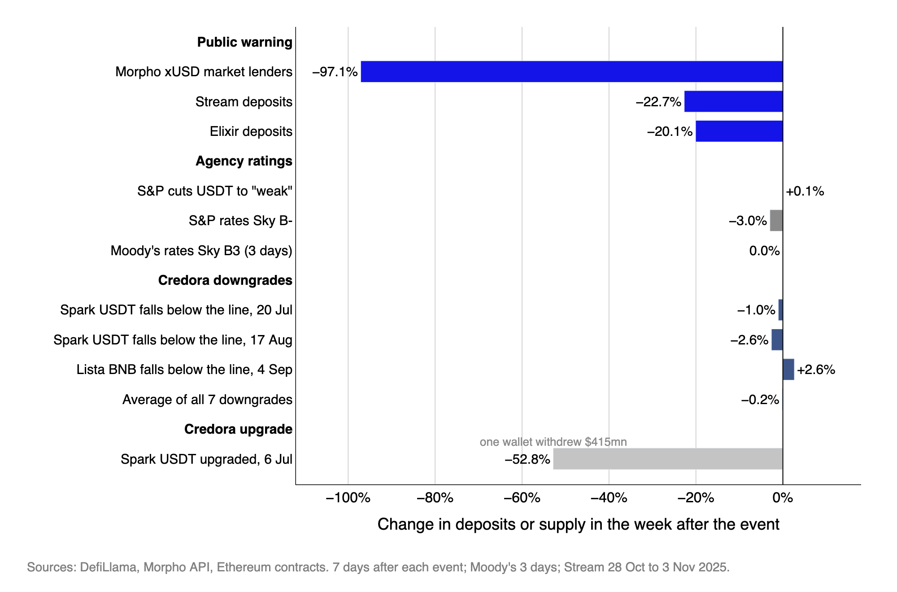

# Onchain Ratings Research

Do crypto credit ratings mean anything yet? Rating agencies started grading DeFi and stablecoins in 2025–26. This repo tests those grades against crypto's own failure history.

All the data, code and charts are here. Every number traces to a public source.

By **Kailen Vyas** (research for *On The Block*, Oct–Nov 2026).

---

## Key findings

### 1. The agencies have arrived, and nothing has passed
- **S&P** rated Sky (issuer of the USDS stablecoin) **B-** in Aug 2025. It was S&P's first rating of a DeFi protocol.
- **Moody's** rated Sky **B3** on 7 Oct 2026. It cited about $90mn of equity against about $10bn of assets.
- **S&P** cut Tether's USDT stability score to **"weak"** in Nov 2025.
- **S&P** launched Vault Risk Assessments on 4 Oct 2026. No vault had been scored by mid-October.
- **S&P and Moody's have not given any DeFi protocol an investment grade.**



### 2. How a stablecoin is built predicts whether it breaks
This covers every USD stablecoin that reached $10mn in supply, 2019 to Oct 2026. A break means trading below $0.95 for 3+ days in a row.

| Design | Broke its peg |
|---|---|
| Algorithmic | **11 of 14 (79%)** |
| Backed by crypto or trading strategies | 20 of 90 (22%) |
| Backed by cash and Treasuries | 3 of 54 (6%) |

The algorithmic group includes five dead coins that DefiLlama no longer lists, added back by hand (see [Dead coins](#dead-coins)).



### 3. The standard risk model missed the crashes
- Across all 21 stablecoins that broke their peg, 99% Value at Risk (VaR) scaled to 30 days expected a median loss of **7%**.
- Holders actually lost a median of **40%** within 30 days.
- Losses beat the model in **15 of 21** cases.
- The coins that lost almost everything (Elixir deUSD, TerraUSD, Stables Labs USDX, Resolv USR) had among the lowest predicted risk.



### 4. Most hack losses come from operations, not code
- DefiLlama records 1,247 hacks from Jan 2020 to 2 Nov 2026, **$21.8bn** in total.
- **66%** of that came from breached servers and laptops, stolen keys, and tricked people.
- This includes the $6.36bn Binance breach of 29 Oct 2026 (preliminary figures), which is about 29% of the total.
- Without that breach, keys and people alone account for 45%.



### 5. Recovery after hacks depends on goodwill, not courts
- The eight largest DeFi-protocol hacks took $2.8bn.
- 36% was returned by the attacker or frozen, 40% was paid by a backer that chose to step in, and 25% was never recovered.



### 6. Ratings did not move money; warnings did (Credora study)
- We built a panel of 260 weekly Credora grades on 10 vaults (Spark and Lista), Feb–Oct 2026.
- **80%** of grades display an "A". Only **37%** are investment grade by Credora's own conversion table (A- maps to BB+/BB).
- After Credora downgrades, deposits barely moved: the average 7-day change across 7 downgrades was **−0.2%**.
- After a public warning about Stream (28 Oct 2025), lenders in the Morpho xUSD market pulled **97%** within a week.
- Yields on governance-set Spark vaults did not price their grades. They paid −0.65 to −0.02 points versus T-bills, while BBB and BB bonds paid +1.0 and +1.7.



Full methods, pre-registered tests and caveats: [`engine/METHODS.md`](engine/METHODS.md). Number-by-number provenance: [`engine/notes/provenance_and_robustness.md`](engine/notes/provenance_and_robustness.md).

---

## All charts
| Folder | What |
|---|---|
| [`2_Charts/x_post/`](2_Charts/x_post) | Seven charts for the X thread (findings 1–5 above, plus stablecoin supply and the agency timeline) |
| [`2_Charts/v2/`](2_Charts/v2) | The figures for "Rating Agencies Are Coming Onchain" (VaR tests, peg breaks, DeFi hack losses vs bond defaults, recovery, timeline) |
| [`2_Charts/final/`](2_Charts/final) | The Credora rating study (grade translation, investment-grade crossings, yields vs bond spreads, ratings vs warnings, USDT, xUSD exit, Morpho curator concentration) |

## Repo layout
```
engine/
  scripts/          build, test and chart scripts (v2_* = stablecoin/hack study, x_post_* = X thread)
  src/              shared rating-scale code (Credora letter -> bond-equivalent grade)
  tests/            offline tests
  data/processed/   every cleaned table the charts read (CSV)
  notes/            provenance, robustness and case checks
  METHODS.md        pre-registered questions, tests, integrity rules, caveats
  run_all.py        one command to rebuild everything
2_Charts/           every final chart (PNG)
```

## Reproduce it
Raw API pulls (about 280MB) are not committed. The scripts re-download them from public APIs.

```bash
pip install -r requirements.txt
cd engine
python run_all.py --online   # download raw data, then rebuild, test and redraw everything
```

Some notes on reproducing:
- The scripts call `curl` for HTTP.
- Fresh pulls will give slightly different numbers, because DefiLlama revises its data and adds new incidents.
- The committed charts and CSVs are the exact versions behind the findings above.

## Data sources
- **DefiLlama:**
  - stablecoin prices and supply (`stablecoins.llama.fi`)
  - hacks database (`api.llama.fi/hacks`)
  - DeFi TVL
  - yields
  - coin prices (`coins.llama.fi`)
- **Credora:** public rating archive (`reports.credora.io`) and its rating-scale table
- **Morpho:** GraphQL API (`api.morpho.org/graphql`)
- **FRED:** ICE BofA corporate spreads by rating, and the 3-month T-bill
- **S&P Global and Moody's:** press releases and coverage (CoinDesk, The Block, Reuters)
- **Hack recoveries:** hand-checked from post-mortems and news (`engine/data/processed/v2_top_hacks_recovery.csv`)

### Dead coins
Peak size of the five algorithmic stablecoins added back, each confirmed above $10mn:

| Coin | Size | Source |
|---|---|---|
| IRON (Iron Finance) | 256M supply at ~$1, 10 Jun 2021 | [Polygonscan via Wayback](https://web.archive.org/web/20210610080844/https://polygonscan.com/token/0xd86b5923f3ad7b585ed81b448170ae026c65ae9a) |
| Basis Cash | $93M peak market cap | [ForkLog, 12 May 2022](https://forklog.com/en/media-terraform-labs-chief-behind-failed-basis-cash-stablecoin-project/) |
| Empty Set Dollar | $134M, 17 Nov 2020 | [CoinGecko via Wayback](https://web.archive.org/web/20201117051843/https://www.coingecko.com/en/coins/empty-set-dollar) |
| Dynamic Set Dollar | $184M, 24 Dec 2020 | [CryptoSlate](https://cryptoslate.com/?p=178381) |
| DEI (Deus Finance) | Over $62M at the May 2022 depeg | [CoinDesk, 16 May 2022](https://www.coindesk.com/markets/2022/05/16/fantom-stablecoin-dei-becomes-latest-to-lose-dollar-peg) |

## Caveats
- **"Broke its peg" is not "defaulted".** Some coins recovered. Fei broke its peg after launch, but holders were later repaid.
- **Stablecoin categories are DefiLlama's labels.** The algorithmic group is small (14 coins), and coins from before 2019 are not included.
- **VaR is the standard market-risk tool.** We do not claim S&P or Moody's use it in their grades.
- **The Binance breach figures are preliminary** (DefiLlama, as of 3 Nov 2026).
- **The Credora study is small:** two platforms, eight months, 7 testable downgrades. It can only detect outflows of about 20% or more.
- **Investment grade** means BBB-/Baa3 or above. Many mandates restrict holdings below it (e.g. the [ECB](https://www.ecb.europa.eu/press/financial-stability-publications/fsr/focus/2020/html/ecb.fsrbox202011_03~578f4f74dc.en.html) and the Eurosystem collateral threshold).

## License
- Code: MIT (see `LICENSE`).
- Charts and derived tables: CC BY 4.0 (credit "Kailen Vyas, Onchain Ratings Research").
- Third-party data stays under its providers' terms.

Code and charts were built with AI assistance (Claude). Analysis choices and conclusions are the authors'.
